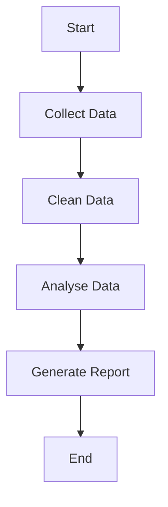
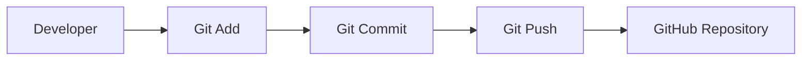
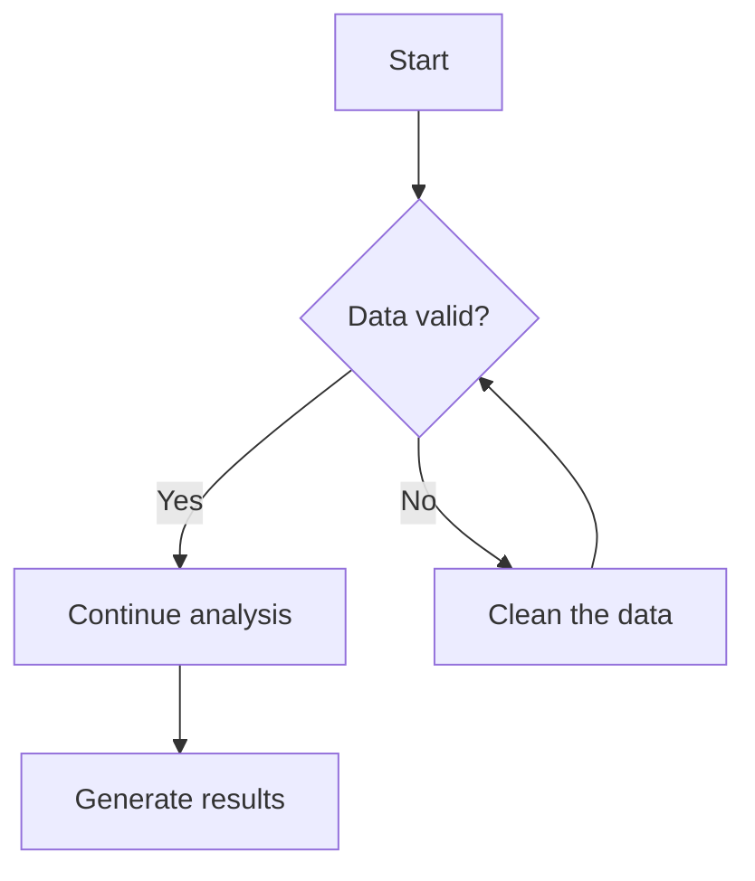
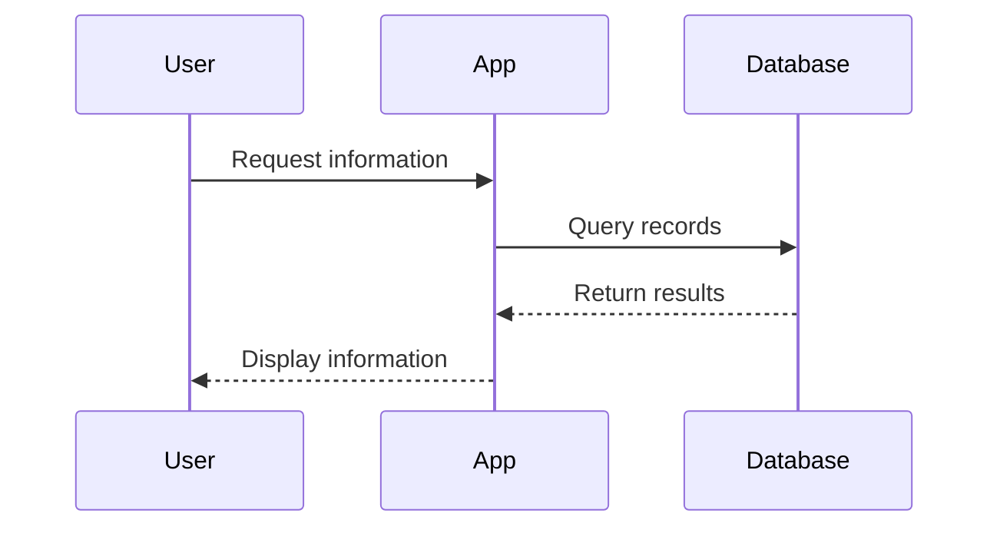

# Professional Markdown Guide

> A practical reference for writing clear, accessible, maintainable Markdown documentation, with a focus on GitHub repositories.

**Audience:** Beginners, developers, data analysts, students, technical writers and contributors  
**File format:** `.md` (Markdown)  
**Primary flavour covered:** GitHub Flavored Markdown (GFM)

---

## Contents

1. [Introduction](#1-introduction)
2. [Markdown flavours and compatibility](#2-markdown-flavours-and-compatibility)
3. [Getting started](#3-getting-started)
4. [Headings and document structure](#4-headings-and-document-structure)
5. [Paragraphs and line breaks](#5-paragraphs-and-line-breaks)
6. [Text formatting](#6-text-formatting)
7. [Lists](#7-lists)
8. [Links and references](#8-links-and-references)
9. [Images](#9-images)
10. [Blockquotes and GitHub alerts](#10-blockquotes-and-github-alerts)
11. [Code and syntax highlighting](#11-code-and-syntax-highlighting)
12. [Tables](#12-tables)
13. [Task lists](#13-task-lists)
14. [Horizontal rules and escaping](#14-horizontal-rules-and-escaping)
15. [HTML in Markdown](#15-html-in-markdown)
16. [Footnotes](#16-footnotes)
17. [Collapsible sections](#17-collapsible-sections)
18. [Mermaid diagrams](#18-mermaid-diagrams)
19. [Mathematical expressions](#19-mathematical-expressions)
20. [GitHub-specific writing features](#20-github-specific-writing-features)
21. [Professional README files](#21-professional-readme-files)
22. [Documentation folder and repository structure](#22-documentation-folder-and-repository-structure)
23. [Markdown style guide and best practices](#23-markdown-style-guide-and-best-practices)
24. [Common mistakes and troubleshooting](#24-common-mistakes-and-troubleshooting)
25. [Quick reference cheat sheet](#25-quick-reference-cheat-sheet)
26. [Practical exercises](#26-practical-exercises)
27. [Example: Complete project README](#27-example-complete-project-readme)
28. [Glossary](#28-glossary)
29. [Official learning resources](#29-official-learning-resources)

---

## 1. Introduction

Markdown is a lightweight markup language. It uses readable punctuation characters to describe the structure and formatting of plain text. A Markdown renderer converts that text into formatted content, commonly HTML.

Markdown is popular because it is:

- **Readable:** The source remains understandable even before it is rendered.
- **Portable:** Markdown files are plain text and can be opened in many editors.
- **Version-control friendly:** Changes can be reviewed clearly in Git diffs.
- **Practical:** It is useful for READMEs, tutorials, notes, reports and technical documentation.
- **Widely supported:** Platforms such as GitHub, GitLab and many documentation tools support Markdown.

### 1.1 Common uses

| File or document | Typical purpose |
|---|---|
| `README.md` | Introduces a repository and explains how to use it |
| `CONTRIBUTING.md` | Explains how to contribute to a project |
| `CHANGELOG.md` | Records notable project changes |
| `CODE_OF_CONDUCT.md` | Sets expectations for community behaviour |
| `docs/installation.md` | Explains installation and setup |
| `docs/analysis.md` | Describes an analytical process |
| `docs/data_dictionary.md` | Defines dataset columns and fields |
| `docs/user_guide.md` | Explains how users operate an application |

### 1.2 Markdown is not a programming language

Markdown describes document structure and presentation. It does not normally execute application logic.

For example:

```markdown
# Project Overview

This project analyses customer purchasing behaviour.
```

The Markdown renderer recognises the heading and paragraph. It does not run them as a program.

---

## 2. Markdown flavours and compatibility

There is not just one implementation of Markdown. Different platforms support different sets of syntax.

### 2.1 CommonMark

CommonMark is a standardised specification that defines core Markdown behaviour. It helps different Markdown processors interpret common syntax consistently.

Core features include:

- Headings
- Paragraphs
- Emphasis
- Lists
- Blockquotes
- Links and images
- Code spans and fenced code blocks
- Thematic breaks

### 2.2 GitHub Flavored Markdown (GFM)

GitHub Flavored Markdown builds on CommonMark and adds features useful for software projects.

Common GFM features include:

- Tables
- Task lists
- Strikethrough
- Autolinks
- GitHub-specific alert syntax
- Additional GitHub platform integrations

GitHub also provides features such as issue and pull request references, mentions and Mermaid diagram rendering in supported contexts.

### 2.3 Compatibility matters

A document that renders correctly on GitHub may not look identical in every Markdown editor.

| Feature | CommonMark core | GitHub Markdown |
|---|---:|---:|
| Headings | Yes | Yes |
| Bold and italic | Yes | Yes |
| Ordered and unordered lists | Yes | Yes |
| Links and images | Yes | Yes |
| Fenced code blocks | Yes | Yes |
| Tables | Extension | Yes |
| Task lists | Extension | Yes |
| Strikethrough | Extension | Yes |
| GitHub alerts | No | Yes |
| Mermaid diagrams | No | Supported |
| Mathematical expressions | No | Supported in GitHub contexts |

**Recommendation:** If your main destination is GitHub, write with GitHub Flavored Markdown in mind. If your files must work across several platforms, favour CommonMark features and test any extensions in each target renderer.

---

## 3. Getting started

### 3.1 Create a Markdown file

A Markdown file normally uses the `.md` extension.

Examples:

```text
README.md
installation.md
analysis.md
user_guide.md
```

The `.markdown` extension is also used, but `.md` is the most common.

### 3.2 Editors

You can write Markdown in:

- Visual Studio Code
- GitHub's web editor
- Notepad or another plain-text editor
- Typora
- Obsidian
- Other Markdown-compatible editors

In Visual Studio Code, open a `.md` file and use the Markdown preview command to see the rendered document. The common preview shortcut is `Ctrl+Shift+V` on Windows and Linux.

### 3.3 A first Markdown document

Create a file named `hello-markdown.md`:

```markdown
# Hello Markdown

This is my first Markdown document.

## About This Document

I am learning how to create structured documentation.

## Topics

- Headings
- Lists
- Links
- Images
- Code blocks
```

Save the file and open its Markdown preview.

---

## 4. Headings and document structure

Headings create a hierarchy and help readers scan a document.

### 4.1 Six heading levels

Use one to six hash (`#`) characters at the beginning of a line.

```markdown
# Heading level 1
## Heading level 2
### Heading level 3
#### Heading level 4
##### Heading level 5
###### Heading level 6
```

| Syntax | Level | Recommended role |
|---|---:|---|
| `#` | H1 | Document title |
| `##` | H2 | Main section |
| `###` | H3 | Subsection |
| `####` | H4 | Detailed subsection |
| `#####` | H5 | Minor topic |
| `######` | H6 | Lowest-level heading |

### 4.2 Recommended hierarchy

For a typical guide:

```markdown
# Python Project Guide

## 1. Project Overview

### 1.1 Purpose

### 1.2 Scope

## 2. Installation

### 2.1 Requirements

### 2.2 Setup
```

### 4.3 Heading best practices

- Use one clear H1 title near the beginning of the document.
- Use H2 headings for the main sections.
- Use H3 headings to divide a main section into related topics.
- Do not choose a heading level just because its rendered text looks larger.
- Avoid skipping levels without a structural reason.
- Keep heading wording concise and descriptive.
- Use consistent capitalisation and numbering.

**Incorrect:**

```markdown
**###### Project Overview**
```

This is not a proper H6 heading. It combines bold emphasis with heading markers in the wrong order.

**Correct:**

```markdown
###### Project Overview
```

---

## 5. Paragraphs and line breaks

### 5.1 Paragraphs

Separate paragraphs with a blank line.

```markdown
Markdown is a lightweight markup language.

It is often used to write project documentation.
```

Without a blank line, two lines may be interpreted as one paragraph.

### 5.2 Line breaks

For a line break within the same paragraph, use two trailing spaces or a backslash at the end of a line. A blank line is usually clearer when you want a new paragraph.

```markdown
First line.  
Second line.
```

**Tip:** Do not add line breaks merely to control the visual width of prose. Renderers and screen sizes vary.

---

## 6. Text formatting

Markdown provides several ways to emphasise text.

### 6.1 Bold

Use two asterisks or two underscores.

```markdown
**This text is bold.**

__This text is also bold.__
```

### 6.2 Italic

Use one asterisk or one underscore.

```markdown
*This text is italic.*

_This text is also italic._
```

### 6.3 Bold and italic

Use three asterisks.

```markdown
***This text is bold and italic.***
```

### 6.4 Strikethrough

GFM supports two tildes around text.

```markdown
~~This task has been cancelled.~~
```

### 6.5 Subscript and superscript

GitHub supports HTML tags for subscript and superscript in supported Markdown contexts.

```markdown
H<sub>2</sub>O

E = mc<sup>2</sup>
```

### 6.6 Underline

There is no standard Markdown underline syntax. In GitHub-supported HTML contexts, you can use:

```html
<ins>This text is underlined.</ins>
```

### 6.7 Formatting reference

| Result | Syntax |
|---|---|
| **Bold** | `**Bold**` |
| *Italic* | `*Italic*` |
| ***Bold and italic*** | `***Bold and italic***` |
| ~~Strikethrough~~ | `~~Strikethrough~~` |
| Subscript | `<sub>text</sub>` |
| Superscript | `<sup>text</sup>` |
| Underline | `<ins>text</ins>` |

**Professional guidance:** Use emphasis to communicate meaning, not as decoration. If every second sentence is bold, the important information becomes harder to identify.

---

## 7. Lists

Lists organise related information and instructions.

### 7.1 Unordered lists

Use a hyphen, asterisk or plus sign followed by a space.

```markdown
- Python
- SQL
- JavaScript
```

These are also valid:

```markdown
* Python
* SQL
* JavaScript
```

```markdown
+ Python
+ SQL
+ JavaScript
```

Choose one marker style and use it consistently.

### 7.2 Ordered lists

Use a number followed by a full stop and a space.

```markdown
1. Create a repository.
2. Add a README file.
3. Commit your changes.
4. Push the changes to GitHub.
```

### 7.3 Nested lists

Indent a child list beneath its parent item.

```markdown
- Programming
  - Python
  - Java
  - JavaScript
- Databases
  - PostgreSQL
  - MySQL
```

For nested lists, use consistent indentation. Four spaces is a safe, readable convention in many Markdown editors.

### 7.4 Lists with paragraphs

A list item can contain more than one paragraph. Indent continuation paragraphs so that they remain part of the same item.

```markdown
1. Install Python.

   Download and install a supported Python version.

2. Create a virtual environment.

   Keep project dependencies separate from other projects.
```

### 7.5 When to use each list type

| List type | Best use |
|---|---|
| Unordered | Related items with no required sequence |
| Ordered | Steps that must be followed in sequence |
| Nested | Parent topics with subtopics |
| Task list | Work that needs to be tracked |

---

## 8. Links and references

Links connect documentation to websites, repository files and other resources.

### 8.1 Basic hyperlinks

Syntax:

```markdown
[Link text](https://example.com)
```

Example:

```markdown
[Visit GitHub](https://github.com)

[Python Documentation](https://docs.python.org/3/)
```

Use descriptive link text. Avoid vague labels such as "click here" when a meaningful title is available.

### 8.2 Links to files in the same repository

Use relative paths to connect Markdown documents.

```markdown
[Installation Guide](./docs/installation.md)

[Analysis Approach](./Docs/analysis.md)
```

### 8.3 Relative path reference

| Path | Meaning |
|---|---|
| `README.md` | File in the current directory |
| `./README.md` | File in the current directory |
| `./docs/guide.md` | File inside a child folder |
| `../guide.md` | File in the parent folder |
| `../../guide.md` | File two folders above |
| `./assets/chart.png` | Image in an assets folder |

### 8.4 Link to a heading

GitHub automatically creates heading anchors.

```markdown
[Installation](#installation)

[Project Objectives](#project-objectives)
```

A heading such as:

```markdown
## Project Objectives
```

normally receives the anchor:

```text
#project-objectives
```

GitHub's anchor generation generally lowercases heading text, replaces spaces with hyphens and handles punctuation according to its heading-anchor rules. Duplicate headings receive distinct anchors. For unusual headings, use GitHub's rendered link or outline to verify the exact anchor.

### 8.5 Reference-style links

Reference-style links separate the visible link from its destination.

```markdown
Read the [GitHub documentation][github-docs].

Read the [Python documentation][python-docs].

[github-docs]: https://docs.github.com/
[python-docs]: https://docs.python.org/3/
```

This is helpful when the same destination is used repeatedly.

### 8.6 Email links

```markdown
[Contact the project maintainer](mailto:maintainer@example.com)
```

Replace the example address with a real project contact address before publishing.

---

## 9. Images

Images can illustrate application interfaces, data visualisations, architecture, diagrams and project results.

### 9.1 Basic image syntax

```markdown

```

The exclamation mark distinguishes an image from an ordinary link.

### 9.2 Image with a title

```markdown

```

### 9.3 Image folder structure

```text
my-project/
├── README.md
├── src/
├── data/
└── assets/
    ├── logo.png
    ├── sales-chart.png
    └── application-screenshot.png
```

Reference an image from the README:

```markdown

```

### 9.4 Alternative text

Alternative text describes the image for people using screen readers and for situations where the image cannot load.

Good:

```markdown

```

Weak:

```markdown

```

### 9.5 Make an image clickable

Place image syntax inside link syntax:

```markdown
[](https://example.com)
```

### 9.6 Image sizing

Standard Markdown does not define a universal image-width attribute. Some platforms support HTML:

```html

```

Use HTML sizing only when the target renderer supports it.

### 9.7 Image troubleshooting

If an image does not display, check:

1. Does the file exist in the repository?
2. Is the path relative to the Markdown file?
3. Is the filename's capitalisation correct?
4. Is the file extension correct?
5. Has the image been committed and pushed?
6. Does the target renderer support the image format?

---

## 10. Blockquotes and GitHub alerts

### 10.1 Basic blockquote

Use `>` followed by a space.

```markdown
> This is a blockquote.
```

### 10.2 Multiple lines

```markdown
> Markdown makes technical documentation easier to maintain.
>
> It is particularly useful for software projects.
```

### 10.3 Nested blockquotes

```markdown
> Main quotation.
>
> > Nested quotation.
```

### 10.4 GitHub alerts

GitHub supports five alert types in supported Markdown contexts.

**NOTE**

```markdown
> [!NOTE]
> Additional information that readers should know.
```

**TIP**

```markdown
> [!TIP]
> Use a virtual environment to isolate project dependencies.
```

**IMPORTANT**

```markdown
> [!IMPORTANT]
> Read the installation instructions before running the application.
```

**WARNING**

```markdown
> [!WARNING]
> Do not commit passwords, tokens or private keys.
```

**CAUTION**

```markdown
> [!CAUTION]
> Back up important data before running destructive operations.
```

Use alerts selectively. Too many alerts make it difficult to distinguish genuinely important information.

---

## 11. Code and syntax highlighting

Code examples are a major part of developer documentation.

### 11.1 Inline code

Use one backtick on each side of a short code element.

```markdown
Run `git status` to check the working tree.
```

Other examples:

```markdown
The variable `user_name` stores a username.

Use `pip install pandas` to install Pandas.

Call `print()` to display a value in Python.
```

### 11.2 Fenced code blocks

Use three backticks before and after a block.

````markdown
```
This is a plain code block.
```
````

### 11.3 Syntax highlighting

Add a language identifier after the opening backticks.

**Python**

````markdown
```python
name = "Darren"
print(name)
```
````

**JavaScript**

````markdown
```javascript
const name = "Darren";
console.log(name);
```
````

**SQL**

````markdown
```sql
SELECT customer_name, total_spent
FROM customers
WHERE total_spent > 1000;
```
````

**HTML**

````markdown
```html
<h1>My Website</h1>
<p>Welcome to my project.</p>
```
````

**CSS**

````markdown
```css
body {
    font-family: Arial, sans-serif;
}
```
````

**Bash**

````markdown
```bash
git status
git add .
git commit -m "Add project documentation"
git push
```
````

**Windows Command Prompt**

````markdown
```cmd
mkdir MyProject
cd MyProject
```
````

**PowerShell**

````markdown
```powershell
Get-ChildItem
Set-Location .\MyProject
```
````

### 11.4 Common language identifiers

| Language | Identifier |
|---|---|
| Python | `python` or `py` |
| JavaScript | `javascript` or `js` |
| TypeScript | `typescript` or `ts` |
| Java | `java` |
| C | `c` |
| C++ | `cpp` |
| C# | `csharp` |
| HTML | `html` |
| CSS | `css` |
| SQL | `sql` |
| Bash | `bash` or `sh` |
| PowerShell | `powershell` or `ps` |
| JSON | `json` |
| YAML | `yaml` |
| XML | `xml` |
| Markdown | `markdown` |
| Plain text | `text` |
| Windows CMD | `cmd` |

The exact aliases supported for syntax highlighting depend on the renderer.

### 11.5 Code blocks containing backticks

If your code example itself contains triple backticks, use a longer outer fence.

`````markdown
````markdown
```python
print("Hello")
```
````
`````

### 11.6 Code documentation best practices

- Identify the language whenever possible.
- Use realistic, short examples.
- Preserve indentation.
- Explain what the code does before or after the example.
- Do not include secrets, access tokens or private credentials.
- Include expected output when it helps the reader.
- Keep examples consistent with the project's actual version and dependencies.

---

## 12. Tables

Tables display structured information in rows and columns.

### 12.1 Basic table

```markdown
| Language | Purpose |
|---|---|
| Python | Data analysis |
| SQL | Database queries |
| JavaScript | Web development |
```

### 12.2 Column alignment

Use colons in the separator row.

```markdown
| Left aligned | Centre aligned | Right aligned |
|:---|:---:|---:|
| Python | SQL | Java |
| Pandas | NumPy | Matplotlib |
```

| Alignment | Separator syntax |
|---|---|
| Left | `:---` |
| Centre | `:---:` |
| Right | `---:` |

### 12.3 Tables for project documentation

A technology table:

```markdown
| Technology | Version | Purpose |
|---|---|---|
| Python | 3.12 | Main language |
| Pandas | 2.x | Data manipulation |
| Matplotlib | 3.x | Visualisation |
```

A data dictionary:

```markdown
| Column | Data type | Description |
|---|---|---|
| customer_id | Integer | Unique customer identifier |
| order_date | Date | Date of the order |
| total_amount | Decimal | Total order value |
```

### 12.4 Table best practices

- Keep column headings short.
- Use tables for genuinely tabular information.
- Avoid very wide tables that are difficult to read on mobile devices.
- Keep the number of columns manageable.
- Use consistent alignment.
- Escape or replace literal pipe characters inside cells where needed.

---

## 13. Task lists

GitHub Flavored Markdown supports task lists.

### 13.1 Uncompleted task

```markdown
- [ ] Create the repository.
```

### 13.2 Completed task

```markdown
- [x] Create the repository.
```

### 13.3 Project checklist

```markdown
## Project Checklist

- [x] Create GitHub repository
- [x] Add README.md
- [ ] Upload source code
- [ ] Add requirements.txt
- [ ] Include project screenshots
- [ ] Complete documentation
- [ ] Review repository before publishing
```

Task lists are useful in GitHub issues, pull requests and Markdown documents supported by GFM.

---

## 14. Horizontal rules and escaping

### 14.1 Horizontal rules

A horizontal rule separates sections.

Use three or more hyphens, asterisks or underscores on their own line.

```markdown
---
```

Alternative forms:

```markdown
***
```

```markdown
___
```

Use horizontal rules to separate major content where appropriate. Do not use them after every paragraph.

### 14.2 Escaping Markdown characters

A backslash (`\`) can prevent certain characters from being interpreted as Markdown formatting.

```markdown
\*This text is not italic.\*

\# This is not a heading.

\`This is not inline code.\`
```

Common characters that can be escaped include:

```text
\ ` * _ { } [ ] ( ) # + - . ! |
```

The exact parsing rules depend on the character and its context.

### 14.3 When escaping is useful

Escaping is particularly useful when:

- Teaching Markdown syntax.
- Showing literal Markdown characters.
- Writing regular expressions or examples containing special punctuation.
- Preventing unintended formatting.

---

## 15. HTML in Markdown

Some Markdown renderers allow HTML elements inside Markdown documents.

### 15.1 Basic HTML example

```html
<p align="center">
  <strong>My Project Documentation</strong>
</p>
```

### 15.2 Line breaks

```html
<br>
```

Prefer Markdown paragraphs and line-break syntax where possible.

### 15.3 Expandable content

```html
<details>
  <summary>View installation instructions</summary>

  1. Clone the repository.
  2. Install dependencies.
  3. Run the application.

</details>
```

### 15.4 HTML comments

HTML comments are not displayed in normal rendered output.

```html
<!-- This is an internal documentation comment. -->
```

### 15.5 Compatibility and security

HTML support varies between Markdown processors. GitHub sanitises HTML for security and may remove unsupported attributes or elements.

Use standard Markdown first. Add HTML only when the intended platform supports the element and it provides a clear benefit.

---

## 16. Footnotes

Footnotes provide supporting information without interrupting the main paragraph.

### 16.1 Basic footnote

```markdown
Python is commonly used for data analysis.[^1]

[^1]: Python has a broad ecosystem of data analysis libraries.
```

### 16.2 Multiple footnotes

```markdown
Pandas is used for data manipulation.[^1]

Matplotlib is used for visualisation.[^2]

[^1]: See the Pandas documentation.
[^2]: See the Matplotlib documentation.
```

Footnote support varies across Markdown platforms. GitHub supports footnotes in supported Markdown documents, but not every GitHub surface supports them.

---

## 17. Collapsible sections

GitHub supports HTML `<details>` and `<summary>` elements in supported Markdown contexts.

### 17.1 Basic example

```html
<details>
  <summary>Show more information</summary>

  This content is hidden until the reader expands the section.

</details>
```

### 17.2 Collapsible code example

```html
<details>
  <summary>View Python example</summary>

  ```python
  numbers = [1, 2, 3, 4, 5]
  print(sum(numbers))
  ```

</details>
```

### 17.3 Good uses

- Frequently asked questions
- Long code samples
- Optional technical details
- Extended installation instructions
- Supporting explanations

Do not hide essential instructions that readers need to understand the project.

---

## 18. Mermaid diagrams

Mermaid creates diagrams from text descriptions. GitHub supports Mermaid diagrams in supported Markdown contexts.

### 18.1 Flowchart

````markdown

````

### 18.2 Left-to-right workflow

````markdown

````

### 18.3 Decision flowchart

````markdown

````

### 18.4 Sequence diagram

````markdown

````

### 18.5 When to use Mermaid

| Diagram | Use |
|---|---|
| Flowchart | Process and decision flows |
| Sequence diagram | Communication between systems |
| Class diagram | Object-oriented structures |
| Entity relationship diagram | Database relationships |
| Gantt chart | Project timelines |
| State diagram | State transitions |

Mermaid is useful for architecture and workflow documentation. Keep diagrams focused and test them in the platform where the document will be published.

---

## 19. Mathematical expressions

GitHub supports mathematical expressions using LaTeX-style syntax in supported Markdown contexts.

### 19.1 Inline expression

```markdown
The area of a circle is $A = \pi r^2$.
```

### 19.2 Block expression

```markdown
$$
E = mc^2
$$
```

### 19.3 Statistical example

```markdown
$$
\text{Mean} = \frac{\sum x_i}{n}
$$
```

### 19.4 Common mathematical symbols

| Symbol | LaTeX |
|---|---|
| π | `\pi` |
| α | `\alpha` |
| β | `\beta` |
| Σ | `\sum` |
| √ | `\sqrt{x}` |
| ≤ | `\leq` |
| ≥ | `\geq` |
| ≠ | `\neq` |
| × | `\times` |
| ÷ | `\div` |

Mathematical rendering is not part of core CommonMark. Check the target platform before relying on it.

---

## 20. GitHub-specific writing features

GitHub adds features that make repository collaboration and documentation easier.

### 20.1 Mentioning users and teams

In supported GitHub contexts, use `@` followed by a username or team name.

```markdown
@username
```

A mention can notify the person or team, depending on the context and notification settings.

### 20.2 Referencing issues and pull requests

GitHub recognises references such as:

```markdown
#25

owner/repository#25
```

These can link to issues or pull requests.

### 20.3 Autolinks

GitHub can automatically recognise certain URLs and references.

```markdown
https://github.com
```

### 20.4 Emoji shortcodes

GitHub supports emoji shortcodes in supported contexts.

```markdown
:+1:
:rocket:
:bug:
:book:
```

Use emoji sparingly in professional technical documentation.

### 20.5 README files

GitHub displays a repository README in prominent places, including the repository's main page. A good README should explain the purpose of the project, how to get started and where to find additional documentation.

---

## 21. Professional README files

A README is often the first document someone sees when opening a GitHub repository.

It should answer these questions:

1. What is this project?
2. What problem does it solve?
3. What technologies does it use?
4. How can someone install or run it?
5. How can someone use or test it?
6. Where can someone find more information?
7. Who created or maintains it?

### 21.1 Recommended README sections

| Section | What to include |
|---|---|
| Project title | Clear project name |
| Overview | Short explanation of the project |
| Objectives | Problems or goals addressed |
| Features | Main functionality |
| Technologies | Languages, libraries and tools |
| Repository structure | Important folders and files |
| Installation | Setup instructions |
| Usage | Commands or examples |
| Screenshots | Relevant application or output images |
| Results | Findings or outcomes |
| Testing | How to run tests |
| Future improvements | Planned enhancements |
| Contributing | How others can contribute |
| Licence | Applicable licence |
| Author | Accurate author or maintainer details |

### 21.2 README writing example

```markdown
# Customer Sales Analysis

## Project Overview

This project analyses customer sales data to identify
purchasing patterns and business performance.

## Objectives

- Analyse monthly sales performance.
- Identify top-performing products.
- Understand customer purchasing behaviour.
- Present insights through visualisations.

## Technologies Used

| Technology | Purpose |
|---|---|
| Python | Data analysis |
| Pandas | Data manipulation |
| Matplotlib | Data visualisation |
| Jupyter Notebook | Exploratory analysis |

## Installation

1. Clone the repository.
2. Install the required dependencies.
3. Open the analysis notebook.

## Results


## Documentation

- [Analysis Approach](./docs/analysis.md)
- [Data Dictionary](./docs/data_dictionary.md)

## Future Improvements

- Add customer segmentation.
- Automate report generation.
- Build an interactive dashboard.

## Author

Project maintained by Your Name.
```

### 21.3 README quality checklist

- [ ] The project title is clear.
- [ ] The overview explains the project's purpose.
- [ ] Objectives are specific.
- [ ] Technologies are listed accurately.
- [ ] Installation instructions work.
- [ ] Usage instructions are included.
- [ ] Images load correctly.
- [ ] Links point to existing files.
- [ ] Repository structure matches the actual project.
- [ ] No secrets or private data are exposed.
- [ ] Author and licence information are accurate.

---

## 22. Documentation folder and repository structure

A professional repository separates source code, data, assets and documentation.

### 22.1 Example structure

```text
customer-sales-analysis/
│
├── README.md
├── requirements.txt
├── .gitignore
├── LICENSE
│
├── data/
│   ├── raw/
│   └── processed/
│
├── notebooks/
│   └── sales_analysis.ipynb
│
├── src/
│   └── main.py
│
├── docs/
│   ├── installation.md
│   ├── analysis.md
│   └── data_dictionary.md
│
├── tests/
│   └── test_analysis.py
│
└── assets/
    ├── monthly-sales.png
    └── product-performance.png
```

### 22.2 What belongs in each folder?

| Folder or file | Responsibility |
|---|---|
| `README.md` | Project introduction and getting started |
| `data/raw/` | Original input data, subject to privacy and licensing rules |
| `data/processed/` | Cleaned or transformed data |
| `notebooks/` | Exploratory analysis notebooks |
| `src/` | Application or analysis source code |
| `docs/` | Detailed supporting documentation |
| `tests/` | Automated tests |
| `assets/` | Images and other documentation assets |
| `requirements.txt` | Python dependency list |
| `.gitignore` | Files and folders Git should ignore |
| `LICENSE` | Project licensing terms |

### 22.3 Linking documentation together

From `README.md`:

```markdown
## Documentation

- [Installation](./docs/installation.md)
- [Analysis Approach](./docs/analysis.md)
- [Data Dictionary](./docs/data_dictionary.md)
```

From `docs/analysis.md`, a link to the root README would be:

```markdown
[Return to Project Overview](../README.md)
```

Always calculate relative paths from the file containing the link, not from the repository root.

---

## 23. Markdown style guide and best practices

Consistent documentation is easier to read, maintain and review.

### 23.1 General style rules

| Area | Recommended practice |
|---|---|
| File extension | Use `.md` |
| Headings | Use a logical hierarchy |
| Main title | Use one clear H1 |
| Paragraphs | Keep them focused |
| Lists | Use consistent markers |
| Links | Use descriptive labels |
| Images | Provide useful alternative text |
| Code blocks | Specify language identifiers |
| Tables | Keep them concise and readable |
| Alerts | Reserve them for important information |
| File paths | Use correct relative paths |
| Naming | Use clear, consistent filenames |
| Updates | Keep documentation aligned with code |

### 23.2 Suggested file naming

Good examples:

```text
README.md
installation.md
analysis-approach.md
data-dictionary.md
contributing.md
```

Avoid unclear names:

```text
file1.md
newdoc.md
stuff.md
final-final-version.md
```

### 23.3 Keep documentation accurate

Documentation should describe the actual project, not an intended or outdated version.

When changing code, consider whether you also need to update:

- Installation instructions
- Usage examples
- Screenshots
- Dependencies
- Configuration instructions
- API references
- Architecture diagrams

### 23.4 Accessibility

- Use meaningful heading text.
- Provide descriptive alternative text for images.
- Do not rely on colour alone to communicate meaning.
- Use descriptive link labels.
- Keep tables simple.
- Use headings in a logical order.

### 23.5 Security

Never publish:

- Passwords
- API keys
- Access tokens
- Private certificates
- Personal information without authorisation
- Confidential business data

A Markdown file is plain text. Anything committed to a public repository may be copied or indexed by others.

---

## 24. Common mistakes and troubleshooting

### 24.1 Headings are not rendering

Incorrect:

```markdown
**## Project Overview**
```

Correct:

```markdown
## Project Overview
```

### 24.2 Lists are not rendering correctly

Incorrect:

```markdown
- Python
-SQL
```

Correct:

```markdown
- Python
- SQL
```

Add a space after the list marker.

### 24.3 Links are not working

Incorrect:

```markdown
[GitHub](https://github.com
```

Correct:

```markdown
[GitHub](https://github.com)
```

Check that the square brackets and parentheses are balanced.

### 24.4 Images are not displaying

Incorrect:

```markdown

```

Correct, if the folder is actually named `assets`:

```markdown

```

Check spelling, capitalisation and the actual repository path.

### 24.5 Code blocks are not closing

Incorrect:

````markdown
```python
print("Hello")
```

Correct:

````markdown
```python
print("Hello")
```
````

The opening and closing fences must match.

### 24.6 Tables are not rendering

Incorrect:

```markdown
| Name | Role |
| Darren | Developer |
```

Correct:

```markdown
| Name | Role |
|---|---|
| Darren | Developer |
```

A table needs a separator row after the header.

### 24.7 Checkboxes are not interactive

The syntax:

```markdown
- [ ] Task
```

is a GFM task-list extension. Not every Markdown renderer displays it as an interactive checkbox.

### 24.8 Markdown looks different across platforms

This is usually a compatibility issue. Check whether the target platform supports the extension you used. When portability matters, use CommonMark core syntax where possible.

---

## 25. Quick reference cheat sheet

| Element | Markdown syntax |
|---|---|
| H1 | `# Heading` |
| H2 | `## Heading` |
| H3 | `### Heading` |
| Bold | `**Text**` |
| Italic | `*Text*` |
| Bold and italic | `***Text***` |
| Strikethrough | `~~Text~~` |
| Unordered list | `- Item` |
| Ordered list | `1. Item` |
| Nested list | Indent child list |
| Task | `- [ ] Task` |
| Completed task | `- [x] Task` |
| Link | `[Text](URL)` |
| Image | `` |
| Blockquote | `> Text` |
| Inline code | `` `code` `` |
| Fenced code | Three backticks |
| Divider | `---` |
| Table | Pipe-separated columns |
| Footnote reference | `[^1]` |
| HTML comment | `<!-- comment -->` |
| GitHub note | `> [!NOTE]` |
| Mermaid | Fenced block with `mermaid` |
| Inline maths | `$expression$` |
| Block maths | `$$expression$$` |

---

## 26. Practical exercises

Use these exercises to practise Markdown in a real GitHub repository.

### Exercise 1: Formatting fundamentals

Create `formatting-practice.md`.

Requirements:

- [ ] Add an H1 heading.
- [ ] Add three H2 headings.
- [ ] Include bold, italic and strikethrough text.
- [ ] Create an unordered list.
- [ ] Create an ordered list.
- [ ] Add a blockquote.
- [ ] Add a horizontal rule.

### Exercise 2: Links and images

Create `links-and-images.md`.

Requirements:

- [ ] Add a link to GitHub.
- [ ] Add a link to the Python documentation.
- [ ] Add a relative link to another Markdown file.
- [ ] Create an `assets` folder.
- [ ] Add an image to the folder.
- [ ] Display the image with descriptive alternative text.

### Exercise 3: Tables and tasks

Create `project-tracker.md`.

Requirements:

- [ ] Add a project progress checklist.
- [ ] Include at least three completed tasks.
- [ ] Include at least three incomplete tasks.
- [ ] Create a table with five technologies.
- [ ] Include each technology's purpose.

### Exercise 4: Code documentation

Create `code-examples.md`.

Requirements:

- [ ] Add a Python code block.
- [ ] Add a JavaScript code block.
- [ ] Add a SQL code block.
- [ ] Add a Bash code block.
- [ ] Explain each example in a short paragraph.

### Exercise 5: Advanced GitHub Markdown

Create `advanced-markdown.md`.

Requirements:

- [ ] Add a GitHub note.
- [ ] Add a GitHub warning.
- [ ] Add a collapsible section.
- [ ] Add a footnote.
- [ ] Add a Mermaid flowchart.
- [ ] Add a mathematical expression.

### Exercise 6: Professional README

Create a README for a fictional data analysis project.

Requirements:

- [ ] Project title and overview
- [ ] Project objectives
- [ ] Technology stack
- [ ] Repository structure
- [ ] Installation instructions
- [ ] Usage instructions
- [ ] Screenshots or graphs
- [ ] Results and findings
- [ ] Future improvements
- [ ] Author information

**Final challenge:** Build the README without copying a template. Organise the information so that a developer unfamiliar with your project can understand it and run it.

---

## 27. Example: Complete project README

The following is a reusable example. Replace the sample project details, paths, commands and results with information that is true for your own project.

````markdown
# Customer Sales Analysis

A Python project exploring customer sales data and identifying
trends in revenue, products and purchasing behaviour.

## Contents

- [Overview](#overview)
- [Objectives](#objectives)
- [Technologies](#technologies)
- [Repository Structure](#repository-structure)
- [Installation](#installation)
- [Usage](#usage)
- [Results](#results)
- [Future Improvements](#future-improvements)
- [Author](#author)

---

## Overview

This project analyses a sample customer sales dataset to
explore revenue trends and product performance.

## Objectives

- Examine sales performance over time.
- Identify high-performing products.
- Explore customer purchasing patterns.
- Communicate findings through visualisations.

## Technologies

| Technology | Purpose |
|---|---|
| Python | Main programming language |
| Pandas | Data cleaning and manipulation |
| Matplotlib | Data visualisation |
| Jupyter Notebook | Exploratory analysis |

## Repository Structure

```text
customer-sales-analysis/
├── README.md
├── data/
├── notebooks/
├── src/
├── docs/
└── assets/
```

## Installation

1. Clone the repository:

   ```bash
   git clone https://github.com/username/customer-sales-analysis.git
   ```

2. Navigate into the project:

   ```bash
   cd customer-sales-analysis
   ```

3. Install dependencies:

   ```bash
   pip install -r requirements.txt
   ```

## Usage

Open the analysis notebook:

```bash
jupyter notebook
```

Run the notebook cells in order.

## Results

Add your actual findings and supporting visualisations here.


## Future Improvements

- Add customer segmentation.
- Automate data updates.
- Build an interactive dashboard.

## Author

Your Name

## Licence

See the [LICENSE](./LICENSE) file.
````

---

## 28. Glossary

| Term | Definition |
|---|---|
| Markdown | Lightweight markup language for formatted text |
| Renderer | Software that converts Markdown into formatted output |
| Parser | Software that interprets Markdown syntax |
| CommonMark | Standardised specification for core Markdown |
| GFM | GitHub Flavored Markdown |
| Heading | A document title or section heading |
| Anchor | A link target, often generated from a heading |
| Relative path | A file location expressed relative to another file |
| Fenced code block | A code block enclosed by backticks or tildes |
| Syntax highlighting | Colouring code according to language syntax |
| Alternative text | Text description of an image |
| Mermaid | Text-based diagramming syntax |
| HTML | Markup language that can be used alongside Markdown in some renderers |
| Repository | A project location managed by Git |
| README | A document introducing a project or repository |

---

## 29. Official learning resources

Use these resources to deepen your understanding and verify platform-specific behaviour.

1. **GitHub – Basic writing and formatting syntax**  
   https://docs.github.com/en/get-started/writing-on-github/getting-started-with-writing-and-formatting-on-github/basic-writing-and-formatting-syntax

2. **GitHub – Getting started with writing and formatting**  
   https://docs.github.com/en/get-started/writing-on-github

3. **GitHub Flavored Markdown specification**  
   https://github.github.com/gfm/

4. **CommonMark specification**  
   https://spec.commonmark.org/current/

5. **Markdown Guide**  
   https://www.markdownguide.org/

6. **W3Schools Markdown tutorial and editor**  
   https://www.w3schools.com/tools/tool_markdown.php

---

## Final recommendations

To become confident with Markdown, practise writing documentation rather than memorising syntax in isolation.

A strong learning sequence is:

1. Learn headings, paragraphs, lists and text formatting.
2. Practise links, images, tables and code blocks.
3. Learn GitHub-specific features such as alerts and task lists.
4. Build a complete README for a real project.
5. Create supporting documentation in a dedicated `docs/` folder.
6. Preview your work and test every link, image and command.
7. Review the document for accuracy, accessibility and consistency.

**Professional standard:** Good Markdown documentation should be easy to navigate, technically accurate, consistent, accessible and useful to someone who has never seen the project before.

---

*End of Markdown Guide.*
